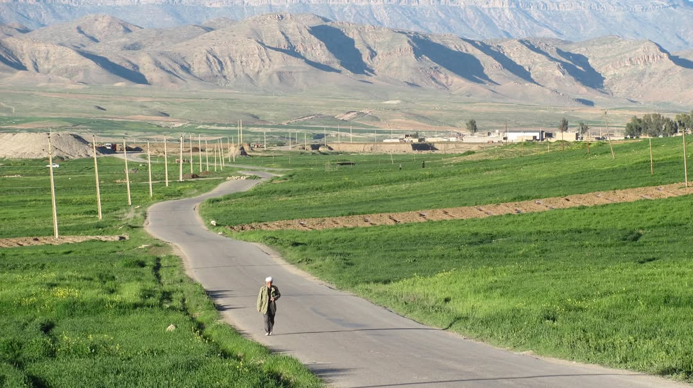

# ***LandVoICE Project***

## *Landscape Vocabulary in the languages of Iran*: Conceptualising Ecosystem across the Zagros mountain and Southern desert ecoregions

> Recent research in language and ecolinguistics shows that different speech communities perceive landscape features and spatial coordinates uniquely, shaped by their cultural beliefs and customs. Key vocabulary related to landscapes reflects diverse mental images and worldviews. 

- Supported by the **Marie Skłodowska-Curie Actions** programme, the **LandVoICE** project will compare landscape vocabulary in selected Iranian and non-Iranian languages spoken in the *Zagros Mountains* and *southern desert/semi-desert* regions of Iran. 
- It will combine Iranian philology and lexicology with ethnophysiography to explore cultural perceptions of the environment. The project will develop culturally appropriate tools, such as mapping systems and ontology-based GIS, to visualise findings, engage communities in ecosystem conservation, and preserve the intangible heritage linked to landscapes.

Here is a link to the [Cordis website](hhttps://cordis.europa.eu/project/id/101202117)

Here is te project logo: 

Here is a nice picture of Lakestan:

